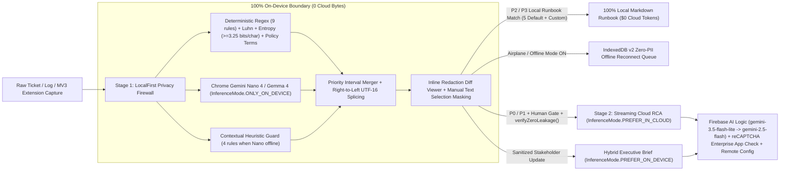

# LocalFirst Triage (`v3.0`)

[](https://para-1-2e22b.web.app)
[](./LICENSE)
[](https://firebase.google.com/docs/ai-logic/hybrid-on-device-inference)
[](./tests)

> **1-Sentence Value Proposition:** Zero-leakage Hybrid AI Incident Copilot & Manifest V3 Chrome Extension that scrubs PII, PHI, and credentials 100% on-device via **Chrome Built-in Gemini Nano 4 / Gemma 4 (`InferenceMode.ONLY_ON_DEVICE`)** before streaming multi-service Root-Cause Analysis from **Cloud Gemini (`gemini-3.5-flash-lite` via `InferenceMode.PREFER_IN_CLOUD`)**.

- **Live Hosted Web PWA:** [**https://para-1-2e22b.web.app**](https://para-1-2e22b.web.app) *(No login required · `$0.00` Firebase Spark Free Tier)*
- **Public Repository:** [**https://github.com/Lion4467cat/localfirst-triage**](https://github.com/Lion4467cat/localfirst-triage)
- **Open-Source License:** [Apache-2.0](./LICENSE)
- **Target Platforms:** Web (Chrome Desktop PWA + Manifest V3 Chrome Extension Side Panel in [`extension/`](./extension))

---

## 60-Second Judge Quickstart

### Path A — Instant Live Evaluation (Works in Any Browser, Zero Flags Needed)
1. Open [**https://para-1-2e22b.web.app**](https://para-1-2e22b.web.app).
2. Click **Scenario 1 (`P0: Semantic PHI + Natural Secret + OAuth Trace`)** → click **Run Hybrid Triage**.
   - Even if Chrome Gemini Nano 4 is not enabled in your browser, Stage 1 pre-masks all **9 sensitive spans** (`4` `[REGEX_FIREWALL]` + `5` `[HEURISTIC_GUARD]`) in `<10ms` and locks the ticket in **Fail-Closed Quarantine (`QUARANTINED_PENDING_APPROVAL`)**.
3. Click any highlighted span or pill in the **Inline Redaction Diff Viewer** to test interactive mask/unmask toggling, or highlight any text to add a custom `[MANUAL_MASK]`.
4. Click **Approve & Escalate Sanitized Payload to Cloud** to stream live **Cloud Gemini (`gemini-3.5-flash-lite`)** Root-Cause Analysis protected by **reCAPTCHA Enterprise App Check**.
5. Open the **Zero-Leakage Proof** tab to inspect the exact literal outbound prompt and verify `ZERO-LEAKAGE VERIFIED: 0 / 9 raw secrets leaked (9 active mask(s))`.
6. Click **Generate Hybrid Stakeholder Brief** (`InferenceMode.PREFER_ON_DEVICE`) to draft a 2-sentence executive summary + Slack incident update.
7. Click **Scenario 2 (`P3: Expired Local Dev TLS Cert`)** or **Scenario 4 (`P2: Field Scanner OAuth Clock Skew`)** to see **100% Local Runbook Resolution (`$0` cloud tokens)**, even with **Airplane / Offline Mode: ON**.

### Path B — Enabling Chrome Built-in Gemini Nano 4 / Gemma 4 (`ONLY_ON_DEVICE`)
1. Open `chrome://flags` in Chrome Desktop (`v138+` / `v149+`) and enable **`Gemma 4 for Built-in AI`** (`#gemma4-for-built-in-ai`), **`Prompt API for Gemini Nano`** (`#prompt-api-for-gemini-nano`), and **`Optimization Guide On Device Model`** (`#optimization-guide-on-device-model` → *Enabled BypassPerfRequirement*).
2. Relaunch Chrome, open [**https://para-1-2e22b.web.app**](https://para-1-2e22b.web.app), and click **Download & Warm Up Nano 4** (or verify readiness at `chrome://on-device-internals`).
3. Once the banner turns green (**`Chrome Gemini Nano 4 is READY`**), run **Scenario 1 (`P0`)** to watch `Stage 1 Firewall: ON_DEVICE (Nano 4)` extract semantic PHI, natural-language password hints, and M&A codenames locally.
   > **Linux Chrome 154 Engineering Note:** On Linux x86_64 builds of Chrome `154.0.8037.57` with dual Intel + NVIDIA GPUs, Chrome's native `libLiteRtWebGpuAccelerator.so` can hit an upstream Clang `-fsanitize=cfi-vcall` cross-DSO vtable trap (`SIGILL` at `+0x8a6084`) during WebGPU delegate creation. LocalFirst Triage was specifically architected to survive browser-native AI process crashes: Stage 1 fails closed into `HEURISTIC_GUARD` + `QUARANTINED_PENDING_APPROVAL` with `0` leaked bytes, and `PREFER_ON_DEVICE` (`generateSanitizedHybridBrief()`) automatically recovers via Cloud Gemini (`IN_CLOUD`) after re-verifying `verifyZeroLeakage()`.

### Path C — Load the Unpacked Chrome Extension Companion (3 Steps)
1. Open `chrome://extensions` in Chrome and toggle **Developer mode** ON.
2. Click **Load unpacked** and select the [`extension/`](./extension) directory of this repository.
3. Highlight any stack trace on GitHub, Jira, Zendesk, PagerDuty, or Linear → right-click **Sanitize & Triage with LocalFirst** → click **Escalate Sanitized to Cloud Workbench** (opens `https://para-1-2e22b.web.app/#handoff=<base64url>` with **only** the sanitized payload).

---

## Hybrid AI Architecture (`firebase/ai`)



---

## Key Features & Verified Specifications

| Capability | Exact Implementation & Specification |
| :--- | :--- |
| **Stage 1 Deterministic Firewall (`[REGEX_FIREWALL]`, `[ENTROPY_SCANNER]`)** | **9** ReDoS-safe deterministic regex patterns (PEM keys, Postgres/Mongo/Redis DB URIs, AWS `AKIA/ASIA` keys, Google/Stripe/GitHub/Slack API keys, Bearer/Basic/JWT tokens, Luhn-validated credit cards, US SSNs, emails, international phone numbers) + Shannon entropy scanner (**`shannonEntropy >= 3.25 bits/char`** or `>=16`-char mixed-class credentials, including JSON-escaped and URL-encoded tokens). |
| **Stage 1 On-Device Semantic Firewall (`InferenceMode.ONLY_ON_DEVICE`)** | Uses `getGenerativeModel(ai, { mode: InferenceMode.ONLY_ON_DEVICE })` backed by Chrome Built-in **Gemini Nano 4 / Gemma 4** (`gemma4_component`) with strict single-session serialization and guaranteed `session.destroy()` cleanup to catch unstructured clinical PHI, natural-language password hints, and confidential M&A codenames (`[NANO_SEMANTIC_FIREWALL]`). |
| **Fail-Closed Quarantine & Heuristic Guard (`[HEURISTIC_GUARD]`)** | Whenever Nano 4 is unavailable, downloading, or recovering from a GPU worker reset, **4** contextual heuristic rules pre-mask unstructured PHI/secrets and hold `P0`/`P1` tickets in `QUARANTINED_PENDING_APPROVAL` until human review. |
| **Mathematical Zero-Leakage Gate (`verifyZeroLeakage()`)** | Audits the exact outbound prompt against all active merged spans **and** every constituent overlapped secret (plus URL-encoded and JSON-escaped variants) before any cloud call. |
| **100% Local P2/P3 Runbooks (`$0` Cloud Cost)** | Ships with **4** distinct demo scenarios (`P0`, `P3`, `P1`, `P2`) and **5** default offline Markdown runbooks (`RB_CERT_EXPIRED`, `RB_OAUTH_CLOCK_SKEW`, `RB_NPM_ERESOLVE`, `RB_CORS_ORIGIN`, `RB_INDEXEDDB_QUOTA`) plus user-defined custom runbooks. |
| **Stage 2 Cloud RCA Streaming (`InferenceMode.PREFER_IN_CLOUD`)** | Streams Markdown RCA from **`gemini-3.5-flash-lite`** via `generateContentStream()` with automatic unary `generateContent()` retry and **`gemini-2.5-flash`** model fallback, plus a deterministic Local Emergency SRE Fallback if offline or blocked by ad-blockers. |
| **Hybrid Stakeholder Brief (`InferenceMode.PREFER_ON_DEVICE`)** | Generates a 2-sentence executive summary and Slack update on-device when Nano 4 is ready, seamlessly falling back to Cloud Gemini (`gemini-3.5-flash-lite`) when unavailable. |
| **Zero-PII `IndexedDB` v2 Storage** | `stripRawTextForStorage()` permanently replaces `rawText` with `"[PURGED_FROM_DISK_FOR_PRIVACY]"` and strips `matchedText` / `constituentTexts` before writing to browser storage. |

---

## Local Development, Testing & Verification

```bash
npm install
cp .env.example .env.local   # Add public Firebase Web config + reCAPTCHA site key
npm test                     # Runs all 9 Vitest suites (60+ unit & adversarial tests)
npm run test:e2e             # Runs headless Playwright Chromium across all 9 E2E flows
npm run build                # Runs tsc --noEmit && vite build (code-split vendor/firebase/app chunks)
npm run dev                  # Starts local Vite server (auto-enables localhost App Check debug token)
```

---

## Originality & Tools Disclosure (`#BuildHybridAI 2026` Rules §6)

- Newly created from scratch between **November 15–30, 2026** specifically for **Google `#BuildHybridAI 2026`**.
- Built with **React 19**, **TypeScript 5.7**, **Vite 6**, **Tailwind CSS v4**, **Lucide React**, **Firebase JS SDK (`firebase@^13.3.0`)**, **Vitest**, and **Playwright Core**.
- Development accelerated using **Google Antigravity IDE**, **Spec-Kit**, **Graphify** (`545 nodes · 961 edges · 0 cycles`), **Floorplan** (`36/36` mapped files), and **Matt Pocock's Architecture & TDD Skills** (`improve-codebase-architecture`, `tdd`).

---

## License

Licensed under the **Apache License 2.0** — see [LICENSE](./LICENSE).
