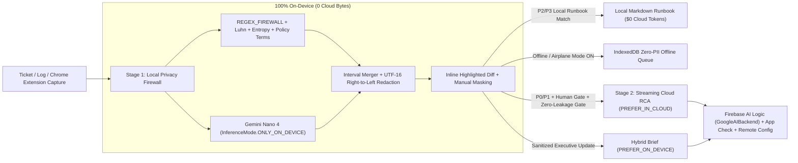

# LocalFirst Triage

**Zero-Leakage Hybrid AI Incident Copilot & Chrome Extension** built for **Google `#BuildHybridAI 2026`** using **Firebase AI Logic (`firebase/ai`)**, **Chrome Built-in Gemini Nano 4 (`ONLY_ON_DEVICE`, `PREFER_ON_DEVICE`, `PREFER_IN_CLOUD`)**, **Firebase App Check**, **Firebase Remote Config**, and **Firebase Hosting (Spark `$0.00` Free Tier)**.

- **Hosted Web PWA:** `https://para-1-2e22b.web.app` *(ready for re-deploy with v3.0 build)*
- **License:** [Apache-2.0](./LICENSE)
- **Target Platforms:** Web (Chrome PWA + Manifest V3 Chrome Extension Side Panel)

---

## Why Hybrid AI Is Essential Here

Conventional cloud AI triage tools force engineering and support teams to send raw stack traces, customer PII, medical PHI, API keys, and M&A codenames off-device—while wasting cloud tokens on repetitive local dev errors.

**LocalFirst Triage** turns **on-device Gemini Nano 4** into an irreplaceable **Stage 1 Semantic Privacy Firewall & Triage Router**:

1. **Deterministic Regex + Luhn + Shannon Entropy (`[REGEX_FIREWALL]`, `[ENTROPY_SCANNER]`):** Instantly redacts AWS keys (`AKIA...`), PEM private keys, Postgres/Mongo/Redis DB URIs, Google/Stripe/GitHub/Slack keys, JWTs & Bearer/Basic Auth headers, Luhn-verified credit cards, US SSNs, emails, international phones, and high-entropy credential assignments.
2. **On-Device Semantic Firewall (`InferenceMode.ONLY_ON_DEVICE` — `[NANO_SEMANTIC_FIREWALL]`):** Strips pure stack frames, chunks long traces (`<=1,400` chars with `120`-char overlap), passes explicit text-only `expectedInputs` + JSON schema `responseConstraint`, and catches unstructured contextual leaks that regex cannot see (clinical PHI, natural-language password hints, internal M&A codenames).
3. **100% Local P2/P3 Runbook Resolution (`$0` Cloud Tokens):** Routine client/dev issues (expired TLS certs, OAuth NTP clock skew, peer dependency conflicts, CORS, stale SW caches, plus user-defined custom runbooks) resolve completely offline with zero cloud calls.
4. **Fail-Closed Quarantine & Programmatic Zero-Leakage Gate:** If Nano 4 is unavailable/downloading on a P0/P1 incident, **Heuristic Guard + Workspace Policy Terms** pre-mask sensitive spans and **hold** cloud escalation until a human reviews the inline highlighted diff (with 1-click pill toggling and manual text masking) and clicks **Approve & Escalate**. Before any cloud dispatch, `verifyZeroLeakage()` programmatically asserts `0` active raw secrets appear in the outbound prompt.
5. **Streaming Cloud RCA (`InferenceMode.PREFER_IN_CLOUD`) + Hybrid Executive Brief (`InferenceMode.PREFER_ON_DEVICE`):** Escalates strictly sanitized P0/P1 payloads to Gemini Flash (model controlled dynamically by Firebase Remote Config `inCloudParams.model`) with real-time token streaming, plus an executive Slack/Jira stakeholder brief powered by `PREFER_ON_DEVICE`.
6. **Manifest V3 Chrome Extension Companion (`/extension`):** Right-click any selected text on GitHub, Jira, Zendesk, PagerDuty, or Linear (or click the Side Panel action) to sanitize locally with Chrome's `LanguageModel` API and optionally hand off **only the sanitized payload** to the Web workbench.

---

## Hybrid Architecture



---

## Firebase Products Used at Runtime

- **Firebase AI Logic (`firebase/ai`):** `getAI(app, { backend: new GoogleAIBackend() })` across `InferenceMode.ONLY_ON_DEVICE`, `InferenceMode.PREFER_ON_DEVICE`, `InferenceMode.PREFER_IN_CLOUD`, `generateContentStream()`, and `initializeDeviceModel()` download progress tracking.
- **Firebase App Check (`firebase/app-check`):** Supports both `ReCaptchaV3Provider` (`VITE_RECAPTCHA_V3_SITE_KEY`, `$0` Spark) and `ReCaptchaEnterpriseProvider` (`VITE_RECAPTCHA_ENTERPRISE_SITE_KEY`), with `FIREBASE_APPCHECK_DEBUG_TOKEN` strictly gated to `localhost`/`127.0.0.1`.
- **Firebase Remote Config (`firebase/remote-config`):** Non-blocking `1500ms` timeout race with hardcoded `defaultConfig` (`cloud_model`, `cloud_fallback_model`, `enable_cloud_escalation`) so Airplane/Offline mode never hangs.
- **Firebase Hosting (Spark Free Tier):** Serves the offline-capable PWA (`public/manifest.json` + `public/sw.js`).
- **Zero-PII Browser Persistence:** Ticket history, custom runbooks, and workspace privacy policy reside in `IndexedDB`, with `stripRawTextForStorage()` purging all raw PII before disk write.

---

## Local Setup, Testing & Build

```bash
npm install
cp .env.example .env.local   # Add your public Firebase Web config + reCAPTCHA site key
npm test                     # Runs all 9 Vitest suites (57 tests)
npm run test:e2e             # Runs Playwright Chromium E2E across 9 user & security flows
npm run build                # Runs tsc --noEmit && vite build (code-split <275 kB chunks)
npm run dev                  # Starts local dev server with localhost App Check debug token
```

### Enabling Chrome Built-in Gemini Nano 4
1. Open `chrome://flags` in Chrome Desktop and search for **`Gemma 4 for Built-in AI`** (enable it; on older builds also check `#prompt-api-for-gemini-nano` and `#optimization-guide-on-device-model` → *Enabled BypassPerfRequirement*).
2. Relaunch Chrome and check model readiness at `chrome://on-device-internals` (or click **Download & Warm Up Nano 4** inside the app HUD).

### Loading the Chrome Extension Companion (Unpacked)
1. Open `chrome://extensions` and enable **Developer mode**.
2. Click **Load unpacked** and select the [`extension/`](./extension) directory.
3. Click the extension toolbar icon to open the Side Panel, or highlight text on GitHub / Jira / Zendesk and right-click → **Sanitize & Triage with LocalFirst**.

---

## Originality & Tools Disclosure (`#BuildHybridAI 2026` Rules §6)

- Newly created from scratch between **November 15–30, 2026** specifically for `#BuildHybridAI 2026`.
- Built with **React 19**, **Vite 6**, **Tailwind CSS v4**, **Lucide React**, **Firebase JS SDK (`firebase@^13.3.0`)**, **Vitest**, and **Playwright Core**.
- Development accelerated using **Google Antigravity IDE**, **Spec-Kit**, **Graphify** (dependency/blast-radius analysis), and **Firebase Agent Skills** (`firebase-ai-logic-basics`, `chrome-extensions`).

---

## License

Licensed under the **Apache License 2.0** — see [LICENSE](./LICENSE).
